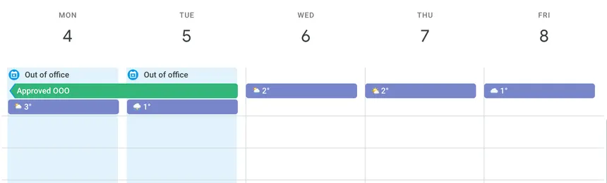
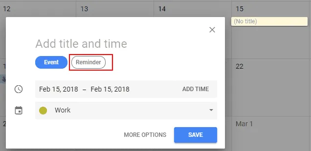

import Estrellas from '../../components/Estrellas.astro'
import GoogleCalendar1 from '../../assets/GoogleCalendar1.webp';
import GoogleCalendar2 from '../../assets/GoogleCalendar2.webp';

# Aplicacion de calendario

## Esta aplicacion, te permite consultar el calendario de los siguientes meses

Permite: 
- Organizar eventos
- Crear recordatorios

### Puntúa la aplicacion
<Estrellas id="app-calendar" />