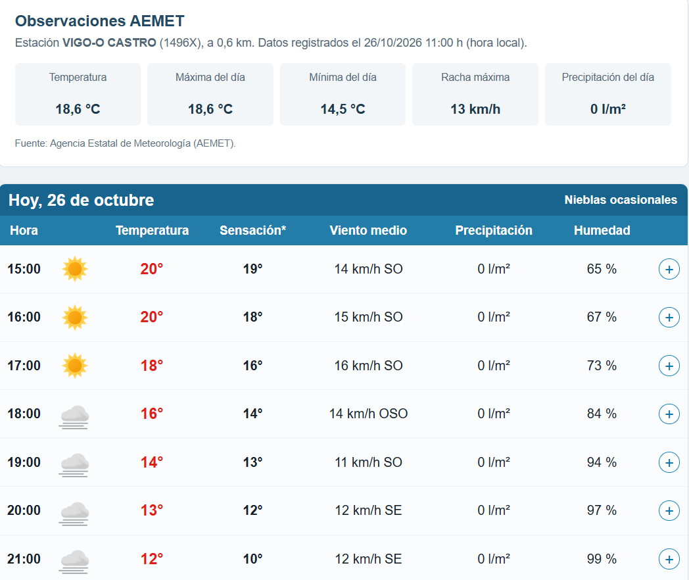
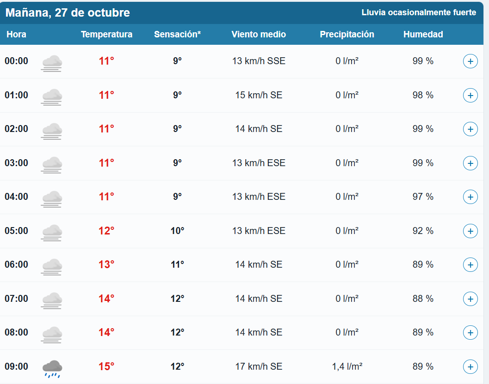

import Estrellas from '../../components/Estrellas.astro'
import aemet26 from '../../assets/AEMET26OCT.png';
import aemet27 from '../../assets/AEMET27OCT.png';

# Aplicación de Consulta del tiempo meteorológico.

Esta aplicacion, muestra el tiempo meteorologico que hará en los proximos 7 dias.

Muestra:
- temperatura máxima y mínima de cada uno de los días.
- Sensación Térmica.
- Probabilidad de Lluvia.
- Calidad del aire

### Puntúa la aplicacion
<Estrellas id="app-meteo" />
